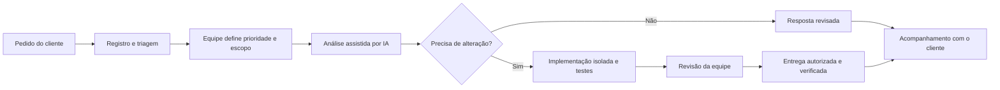

# Painel administrativo e portal do cliente Olivaw

## Estado da proposta

Documento de idealização solicitado pelo mantenedor em 20/10/2026. Organiza a visão de produto e um caminho de implementação futura. Não representa funcionalidades entregues, serviços contratados, limites comerciais aprovados ou autorização para provisionar recursos e executar ações remotas.

A proposta tem duas fases:

- **Fase 1 — Operação Olivaw:** painel interno para cadastrar clientes, conhecer seus recursos, acompanhar saúde, consumo, alertas e atendimento.
- **Fase 2 — Meu negócio:** portal em que cada cliente acompanha seus próprios sistemas, entende seu plano e solicita ajuda ou melhorias. O atendimento ganha apoio progressivo de agentes de IA, com acompanhamento da equipe.

A experiência deve transmitir a Olivaw como uma presença tecnológica que entende, acompanha e cuida. Modernidade aparece na clareza e na conexão entre informações, com a identidade do robô e movimentos suaves.

## Princípios do produto

- Começar mostrando o que precisa de atenção e qual é o próximo passo possível.
- Dar a cada informação um contexto: cliente, projeto, recurso, ambiente e período.
- Separar a profundidade técnica da operação da linguagem cotidiana do cliente.
- Mostrar consumo e capacidade com transparência, preservando a previsibilidade dos planos.
- Tratar cadastro, monitoramento, incidentes, atendimento e evolução como partes conectadas da relação com o cliente.
- Distinguir dados medidos, estimativas, informações manuais e ausência de coleta.
- Usar IA para reduzir trabalho e acelerar entregas, mantendo evidências e responsabilidade sobre decisões.
- Ter uma experiência útil com um cliente real, sem estatísticas fictícias ou grades de conteúdo vazio para parecer maior.

## O que existe e o que falta

| Base observada no repositório | Como aproveitar | O que não presumir |
| --- | --- | --- |
| Login e rota `/admin` no frontend Olivaw | Ponto de entrada da administração | A tela atual é uma base com saudação e saída; não contém a operação proposta |
| Identidade administrativa da `ms-olivaw-api` e biblioteca Olivaw Identity | Acesso humano da equipe, perfis e permissões | Cadastro de cliente não é cadastro de usuário, nem conta técnica |
| Identidades próprias das APIs dos clientes | Preservar autonomia e isolamento | JWT da LTMJ não dá acesso ao painel interno Olivaw |
| API DevOps com jobs de implantação e limpeza | Integrar acompanhamento de operações autorizadas | O job de implantação atual não comprova saúde funcional após publicar nem oferece rollback automático |
| Readiness e instrumentação compartilhada configurável | Possíveis fontes de sinais e links técnicos | A existência de código de métricas não comprova que coleta, histórico e dashboards estejam ativos em produção |
| Captação de leads e jornada comercial | Futuramente acompanhar a passagem de lead para cliente | Lead enviado não deve virar cliente ativo ou receber recursos automaticamente |
| LTMJ como primeiro cliente informado pelo mantenedor | Primeiro caso de cadastro e avaliação da experiência | Não inventar seu consumo, disponibilidade histórica, plano ou metas de atendimento |

Referências locais: [administração atual](../../ms-olivaw-ng/src/app/features/admin/admin-page.ts), [API Olivaw](../../ms-olivaw-api/README.md), [identidade](../../olivaw-identity/README.md), [API DevOps](../../ms-devops-api/README.md) e [executor](../deploy-executor.md).

## Referências de mercado

Pesquisa em documentação oficial consultada em 20/10/2026. As referências inspiram comportamentos; não implicam contratação dessas plataformas ou adoção integral de seus produtos. A tradução para a Olivaw abaixo é uma proposta nossa.

| Referência | Comportamento observado | Aplicação proposta na Olivaw |
| --- | --- | --- |
| [Vercel Observability](https://vercel.com/docs/observability) | Relaciona métricas, logs e rastros para investigar projetos | Visão geral simples com aprofundamento por sistema, ambiente e ocorrência |
| [Vercel Spend Management](https://vercel.com/docs/spend-management) | Trabalha com limites, notificações e ações relacionadas a consumo | Antecipar necessidade de capacidade. Não copiar suspensão automática de produção como política padrão |
| [Grafana: agrupamento de notificações](https://grafana.com/docs/grafana/latest/alerting/fundamentals/notifications/group-alert-notifications/) | Agrupa alertas relacionados e controla repetição | Uma falha compartilhada deve gerar um incidente compreensível, sem centenas de avisos equivalentes |
| [Grafana: ausência de dados e erro](https://grafana.com/docs/grafana/latest/alerting/fundamentals/alert-rule-evaluation/nodata-and-error-states/) | Distingue ausência de resultados de falha na avaliação | Diferenciar “sem coleta”, “coleta atrasada” e “sistema indisponível” |
| [Atlassian Statuspage](https://support.atlassian.com/statuspage/docs/what-is-statuspage/) | Apresenta componentes, incidentes, histórico e atualizações aos interessados | Informar impacto e andamento para o cliente sem expor detalhes internos |
| [Zendesk Customer Portal](https://support.zendesk.com/hc/en-us/articles/4408846805530-Submitting-and-tracking-requests-in-the-help-center-Customer-Portal) | Permite abrir, acompanhar, comentar e consultar solicitações | Uma conversa rastreável com protocolo e histórico no portal |
| [Zendesk: transferência entre IA e equipe](https://support.zendesk.com/hc/en-us/articles/4408824482586-Managing-conversation-handoff-and-handback) | Distingue quem está conduzindo o atendimento | Mostrar quando uma análise é assistida e permitir continuidade humana com contexto |
| [Linear Customer Requests](https://linear.app/docs/customer-requests) | Liga pedidos de clientes a itens de trabalho e projetos | Conectar a mensagem original à melhoria planejada, à implementação e à entrega |
| [Stripe Customer Portal](https://docs.stripe.com/customer-management) | Oferece autoatendimento relacionado a conta e assinatura | Evolução futura para consultar plano e condições. Pagamentos e mudanças contratuais não entram automaticamente no MVP |

A combinação desejada é: profundidade operacional quando necessária, acompanhamento de solicitações fácil de entender e uma camada própria da Olivaw para conectar essas informações.

## Fase 1 — Operação Olivaw

### Quem acessa

Acesso exclusivo à operação autorizada da Olivaw. Root administra a plataforma; perfis delegados permitem distribuir responsabilidades sem entregar poderes completos a toda a equipe.

Papéis iniciais propostos:

- **Administrador da operação:** clientes, vínculos, recursos, permissões e configurações.
- **Operação técnica:** saúde, incidentes, investigação e ações técnicas explicitamente permitidas.
- **Atendimento:** solicitações, comunicação com clientes e acompanhamento de entregas.
- **Comercial/financeiro:** condições do plano, capacidade contratada e análise de custos autorizada.
- **Consulta:** visualização permitida, sem alterações.

São papéis de produto a mapear para permissões reais; não novos usuários ou perfis já existentes. Root não substitui o desenho das permissões e não deve ser a conta cotidiana de todos os operadores.

### Navegação principal

Manter seis entradas principais na lateral:

- **Visão geral:** situação atual e prioridades.
- **Clientes:** cadastro e ficha de cada empresa.
- **Operação:** recursos, saúde, incidentes, backups e publicações.
- **Consumo:** capacidade, tendências e custo interno.
- **Atendimento:** problemas, dúvidas, melhorias e entregas.
- **Agentes:** fila, análises, execuções e revisões.

Configurações, equipe e auditoria ficam no rodapé da navegação, conforme permissão. A ficha de um cliente concentra suas abas; não repetir dezenas de itens no menu global.

O cabeçalho mostra busca, escopo atual, ambiente e notificações. Em uma visão agregada, deixar explícito “Todos os clientes”; na ficha, mostrar o nome do cliente. Produção precisa de identificação inequívoca antes de qualquer ação operacional.

### Visão geral — o que precisa de atenção

A primeira tela responde: “Quem está precisando da Olivaw agora?”

- Resumo com até quatro indicadores: clientes acompanhados, sistemas com impacto confirmado, alertas que exigem ação e solicitações aguardando resposta.
- Fila priorizada com cliente, impacto, momento da detecção, responsável e próxima ação.
- Lista de clientes com situação resumida e momento da última coleta.
- Histórico curto de mudanças: publicação, início de incidente, atualização do atendimento e recuperação confirmada.
- Filtros por cliente, projeto, ambiente e período, com estado compartilhável na navegação interna.

Um número abre a lista que o explica. Aumentar o total de alertas não deve tornar a página mais importante que o incidente que afetou um cliente.

### Cadastro e ficha do cliente

Cliente é a empresa atendida. Ela pode ter vários contatos, usuários do portal, projetos, sistemas, planos e recursos.

Cadastro progressivo proposto:

- Nome comercial, razão social e dados cadastrais necessários à relação, sem exigir todos na criação inicial.
- Contatos responsáveis pelo negócio, operação, atendimento e contratação.
- Responsável interno da Olivaw, observações e canais combinados.
- Situação: em implantação, ativo, pausado ou encerrado, com regras de transição ainda a definir.
- Projetos vinculados, ambientes e endereços públicos.
- Plano/contrato vigente, início de vigência, limites e exceções aprovadas.
- Histórico de alterações, atendimento e entregas.

Abas da ficha: **Resumo · Sistemas e recursos · Saúde · Consumo · Atendimento · Plano e histórico**.

Uma alteração cadastral não provisiona servidor nem muda cobrança por efeito colateral. Conversão de lead em cliente deve ser uma ação explícita, preservando a origem e permitindo resolver duplicidades.

### Inventário de sistemas e recursos

Construir uma relação compreensível entre:

**Cliente → Projeto → Ambiente → Sistema → Recursos e dependências.**

Exemplos de recursos: frontend, API, banco, armazenamento de arquivos, domínio, certificado, rotina de backup e tarefa agendada. Um recurso compartilhado pode atender vários sistemas; não duplicá-lo como se fosse uma máquina exclusiva de cada cliente.

Para cada recurso, registrar finalidade, proprietário, identificador no provedor, ambiente, dependências, fonte de monitoramento e política de coleta. Recursos sem medição ficam identificados como inventariados, sem dados operacionais confirmados.

A ficha deve permitir responder:

- Quais serviços compõem o sistema deste cliente?
- Qual recurso é exclusivo e qual é compartilhado?
- Quem atualiza, monitora e cuida dessa parte?
- Quais sistemas seriam afetados pela falha desse recurso?
- Quais domínios e certificados exigem renovação?

Nunca mostrar credenciais ou arquivos de segredo na ficha. Para acesso operacional, guardar referências a credenciais e usar o mecanismo autorizado da operação.

### Saúde e observabilidade

“Monitoramento completo” deve significar cobertura conhecida, com fontes e lacunas visíveis. Não equivale a afirmar que todos os dados já são coletados ou que uma página de gráficos detectará qualquer falha.

| Dimensão | Sinais possíveis | Observação para interpretar |
| --- | --- | --- |
| Experiência externa | Disponibilidade HTTP, latência, DNS e certificado | O site responder não comprova funcionamento de todos os fluxos |
| Aplicação | Readiness, erros, tempos de resposta e tarefas essenciais | Distinguir saúde técnica de transação de negócio concluída |
| Infraestrutura | CPU, memória, disco e reinícios | Uso do host compartilhado não é consumo individual de um cliente |
| Dados | Tamanho do banco, conexões, falhas e tempos de consulta | Observar por fonte autorizada, sem abrir dados de negócio desnecessários |
| Proteção e recuperação | Último backup, resultado, retenção e teste de restauração | “Backup executado” e “restauração testada” são informações diferentes |
| Entrega | Versão, publicação, resultado do job e verificação posterior | Build ou Compose bem-sucedido não comprova saúde do aplicativo |
| Negócio | Pedidos, contatos ou tarefas concluídas | Cada métrica exige definição própria; só incluir se útil e acordada |

Estados propostos: **Operacional · Atenção · Incidente confirmado · Manutenção · Sem monitoramento · Dados desatualizados**.

Critérios de avaliação devem considerar criticidade, janela de observação, repetição de falhas e dependências. Um banco indisponível pode afetar uma área interna enquanto uma landing page estática continua acessível. Mostrar impacto por função, sem pintar todo o cliente como indisponível sem evidência.

Exibir fonte, última atualização, cobertura do período e fuso. Ausência de alertas não é evidência suficiente para apresentar “100% saudável”. Se não houver histórico, mostrar “Ainda não temos dados suficientes”.

### Alertas e incidentes

Alerta é um sinal que merece avaliação; incidente é uma ocorrência acompanhada pela operação, com impacto e responsável. Vários alertas podem pertencer ao mesmo incidente.

Fluxo proposto: **Detectado → Em avaliação → Em atendimento → Em observação → Resolvido**. “Reconhecido pela equipe” é uma ação auditável, não sinônimo de resolvido.

Cada ocorrência reúne evidências, cliente/sistemas afetados, gravidade, responsável, linha do tempo e próxima atualização. Anotações internas e comunicados ao cliente têm visibilidades distintas.

Comportamentos importantes:

- Agrupar sinais da mesma causa e indicar os clientes afetados por uma falha compartilhada.
- Evitar repetição contínua de avisos; aplicar agrupamento, intervalo e regras de recuperação.
- Permitir manutenção programada e silenciamento com motivo, responsável e expiração.
- Distinguir silêncio de notificações de desativação da coleta.
- Escalar quando não houver atendimento dentro da política acordada, sem prometer um SLA ainda não contratado.
- Registrar quem recebeu e quem reconheceu o aviso; notificação enviada não comprova leitura.
- Comunicar recuperação depois de uma janela de confirmação adequada.

O MVP começa com central interna de alertas. E-mail e outros canais dependem de configuração, destinatários, testes e política de envio. Não presumir integração pronta com WhatsApp ou atendimento humano permanente.

## Consumo, capacidade e planos

### Três informações diferentes

| Informação | Pergunta que responde | Público principal |
| --- | --- | --- |
| Consumo técnico | Quanto foi efetivamente utilizado, em qual unidade e período? | Operação; cliente apenas no recorte útil |
| Custo interno | Quanto custa operar e atender esse cliente, incluindo recursos compartilhados? | Equipe autorizada Olivaw |
| Plano contratado | Qual mensalidade, capacidade e serviços foram combinados? | Olivaw e cliente |

CPU elevada não vira cobrança automaticamente. Estimativa de custo não é fatura. O desenho comercial continua baseado em planos previsíveis, com mudança de condições combinada antes. Consultar [custos e planos](custos-e-planos.md).

### Definição das medições

| Métrica proposta | Natureza e período | Cuidado de atribuição |
| --- | --- | --- |
| Arquivos do cliente | Espaço ocupado no instante da coleta e evolução | Separar arquivos úteis, temporários e cópias de backup |
| Banco de dados | Tamanho no instante da coleta | Definir se o valor inclui índices e outros componentes |
| Tráfego de saída | Volume acumulado no ciclo, a partir de incrementos | Não somar repetidamente o mesmo contador cumulativo |
| Requisições | Quantidade por ciclo e taxa por intervalo | Requisições não são pessoas ou visitas únicas |
| CPU e memória | Média/pico por intervalo, conforme a fonte | Não repartir o uso total da VM arbitrariamente e chamar de medição |
| Backups | Volume, execuções, falhas e cobertura da retenção | Separar capacidade ocupada de quantidade de execuções |
| Atendimento e evolução | Franquia, reservas e uso validado no ciclo | Ticket aberto não consome automaticamente uma melhoria contratada |
| Agentes de IA | Execuções, tempo, tokens e custo estimado por tarefa | Definir o que é custo interno e o que, se aprovado, compõe uma condição comercial |

Cada medida precisa de definição, unidade, origem, instante de coleta, intervalo coberto, identificação estável e regra de consolidação. Armazenar instantes em UTC e apresentar o período de forma clara; definir se capacidade usa GB ou GiB. Reprocessar uma coleta não pode duplicar o consumo.

Mostrar atraso, falha e estimativa explicitamente. Para recurso compartilhado, manter parcela não atribuída e regra de rateio versionada para análise de custo interno. Reconciliação com dados dos provedores é uma evolução necessária antes de usar medições para decisões financeiras.

### Experiência de acompanhamento

- Barras discretas de uso e limite, com valores absolutos e ciclo vigente.
- Tendência de crescimento acompanhada de cobertura dos dados, sem previsões categóricas com amostras pequenas.
- Avisos progressivos antes de atingir capacidade; percentuais serão parâmetros definidos na implementação.
- Histórico das condições e limites de cada plano, respeitando sua vigência.
- Visão interna de custo estimado, rateio e sustentabilidade do contrato, sem expor margem comercial ao cliente.
- Solicitação de avaliação de capacidade quando necessário; sem upgrade, cobrança extra ou suspensão automática por padrão.

Exemplos de tela devem usar dados de demonstração identificados. Um cenário como “2,4 GB de 10 GB” não aprova uma franquia de 10 GB para nenhum plano atual.

## Fase 2 — Meu negócio

### Uma experiência própria para o cliente

A área do cliente pertence ao relacionamento com a Olivaw. Ela não substitui automaticamente a administração do aplicativo do cliente, como a gestão de eventos da LTMJ.

Tela inicial proposta:

- Nome da empresa, sistema selecionado e acesso ao site/aplicativo.
- Situação atual em linguagem simples e horário da última verificação.
- Capacidade e uso do plano que tenham significado para aquele cliente.
- Atualização recente do projeto e acompanhamento do que está em atendimento.
- Ações **“Preciso de ajuda”**, **“Quero uma melhoria”** e **“Tenho uma dúvida”**.

Navegação: **Meu negócio · Minhas solicitações · Evolução · Meu plano · Minha equipe**. A última opção depende do papel do usuário. Um contato vinculado a mais de uma empresa só pode alternar entre empresas às quais recebeu acesso explícito.

### Tradução da linguagem

| Operação interna | Comunicação ao cliente |
| --- | --- |
| Verificação externa respondeu dentro da janela esperada | “Seu site está disponível. Verificado às [hora].” |
| Aumento sustentado de latência em uma função | “Uma parte do sistema está mais lenta. Estamos acompanhando.” |
| Coleta atrasada | “Estamos atualizando a verificação. O estado atual ainda não foi confirmado.” |
| Backup executado com sucesso | “A cópia de segurança prevista foi concluída em [data].” |
| Armazenamento se aproximando do limite | “Seu espaço está crescendo. Podemos avaliar juntos o próximo passo.” |
| Correção em revisão | “Ajuste preparado e em revisão pela equipe.” |
| Entrega publicada e verificada | “A atualização está disponível. Veja o que mudou.” |

Não apresentar diagnóstico de causa ou prazo de recuperação como confirmado antes da avaliação. O cliente vê fatos relevantes ao seu sistema, sem stack traces, topologia privada, dados de outros clientes ou custos internos.

### Meu plano e evolução

Mostrar serviços contratados, capacidade, uso, ciclo e condições aplicáveis. Quando existirem franquias de alterações, apresentar o que está disponível, reservado, concluído ou em avaliação, com histórico compreensível.

Correção de falha, manutenção, pequeno ajuste e funcionalidade nova precisam de classificação e condições próprias. Uma sugestão enviada pelo cliente não altera contrato, não consome franquia imediatamente e não cria promessa de prazo.

O cliente pode pedir revisão do plano. A proposta e a aprovação vêm antes de alterar condições. Faturas, pagamentos e contratação automática ficam para uma evolução posterior, depois da definição comercial.

## Atendimento e pedidos de melhoria

### Abertura simples

O cliente escolhe um sistema, indica o tipo de pedido e escreve com suas palavras. Usar poucas perguntas iniciais e complementar quando necessário.

- **Problema:** o que tentou fazer, o que aconteceu e quando percebeu.
- **Melhoria:** o que gostaria de conseguir fazer e quem seria ajudado.
- **Dúvida:** qual informação ou orientação precisa.

Sistema e identidade vêm do contexto autorizado. A indicação de impacto pelo cliente ajuda a triagem, mas não concede prioridade operacional ilimitada. Um problema com impacto amplo deve chamar a equipe sem depender de completar uma análise por IA.

Começar com texto e referências a páginas do sistema. Prints e anexos são evolução, após definir acesso, tamanho, armazenamento, retenção e tratamento de arquivos.

### Protocolo e acompanhamento

Cada pedido possui identificação, cliente, sistema, solicitante, tipo, impacto relatado, responsável, estado, conversa e histórico.

Estados externos propostos: **Recebido · Em análise · Aguardando você · Planejado · Em execução · Em validação · Entregue · Encerrado**. Pedidos também podem ser cancelados ou recusados com motivo. O fluxo não precisa passar por todos os estados para toda dúvida.

- Mensagens públicas e notas internas são separadas e autorizadas no servidor.
- Dúvidas podem ser resolvidas com uma resposta; melhorias podem exigir proposta e aceite de escopo.
- Uma tarefa técnica pode atender vários pedidos, preservando a conversa privada de cada cliente.
- Relatos ligados a um incidente mostram seu andamento, sem criar várias implementações duplicadas.
- Entrega mostra resumo do que mudou e orientação de validação; cliente pode relatar persistência do problema.
- Encerramento e reabertura têm regras claras. Não encerrar automaticamente uma reclamação apenas porque a IA produziu uma resposta.

A visão interna prioriza impacto, responsável e próximo passo. A visão do cliente prioriza andamento, resposta e expectativa combinada.

## Agentes de IA no atendimento e na evolução

### Papel proposto

Os agentes podem preparar triagem, investigar contexto autorizado, sugerir respostas, organizar requisitos e produzir alterações testáveis. O primeiro ganho deve ser diminuir o tempo gasto reunindo informações, sem criar um atendente que inventa certezas ou aprova sozinho o próprio trabalho.

Papéis de execução possíveis, introduzidos conforme necessidade:

- **Triagem:** resumir o pedido, sugerir categoria, identificar informação faltante e possíveis duplicidades.
- **Diagnóstico:** correlacionar sinais e documentação autorizados, citando evidências e distinguindo hipótese de causa confirmada.
- **Requisitos:** transformar uma melhoria em critérios de aceite e sugestão de etapa.
- **Implementação:** preparar um patch em ambiente isolado e executar verificações adequadas.
- **Revisão e comunicação:** apontar riscos, resumir testes e preparar uma explicação compreensível para a equipe revisar.

São papéis, não uma obrigação de criar vários processos ou modelos desde o primeiro dia. Só acrescentar especializações quando trouxerem benefício comprovado.

### Fluxo de trabalho



Incidentes urgentes têm caminho direto para atendimento humano. A fila de agentes não pode ser um bloqueio para a operação.

### Níveis de autonomia

| Etapa | Primeira modalidade proposta | Limite |
| --- | --- | --- |
| Resumo e classificação | Sugestão automática interna | A equipe pode corrigir; texto do cliente é preservado |
| Diagnóstico | Consulta de fontes autorizadas, com evidências | Sem execução em produção ou acesso geral aos dados do cliente |
| Resposta ao cliente | Rascunho revisado por pessoa | Automação futura restrita a casos aprovados e avaliados |
| Desenvolvimento | Alteração isolada com testes e diff revisável | Não conceder acesso a todos os repositórios ou segredos |
| Escopo, prioridade e investimento | Decisão da equipe; aceite do cliente quando aplicável | A IA não promete prazo, desconto, franquia ou aprovação comercial |
| Merge, publicação e ações de infraestrutura | Aprovação operacional explícita | Não executar pela simples existência de um ticket |

A implementação assistida deve respeitar o Git Flow do repositório, vincular trabalho a issue quando houver e preservar rastreabilidade. PR é opcional; revisão não exige impor um fluxo diferente do adotado. Não fechar issues ao integrar em `develop`; seguir as regras de entrega e publicação existentes.

### Centro de agentes

Mostrar fila, cliente/projeto, objetivo, execução atual, evidências, resultado, verificações, custo estimado e ação aguardada. Estados: **Na fila · Em análise · Preparando alteração · Verificando · Aguardando revisão · Concluído · Falhou · Cancelado**.

O operador pode inspecionar resultados, aprovar a próxima etapa permitida, pedir nova análise, cancelar ou assumir o caso. Limitar concorrência, duração, tentativas e orçamento por execução, além de evitar que um cliente ocupe indefinidamente toda a capacidade.

Cada execução registra versão das instruções, modelo utilizado, ferramentas permitidas, referências consultadas, artefatos, validações e decisões humanas. Logs devem ser úteis e redigidos sem expor segredos. Texto de ticket, anexos e páginas consultadas são dados externos: não podem alterar permissões ou autorizar operações por instruções embutidas.

Medir tempo até a primeira resposta útil, tempo de resolução, reaberturas, aceitação das sugestões, custo por tarefa, falhas e qualidade das entregas. Velocidade isolada ou volume de respostas não comprovam melhoria de atendimento.

## Identidade, isolamento e responsabilidades

### Acesso entre clientes

- Manter a autoridade administrativa interna da Olivaw separada das identidades dos aplicativos dos clientes.
- A identidade do futuro portal de relacionamento é uma decisão arquitetural da fase 2. A preferência proposta é uma autoridade externa própria, reutilizando a biblioteca, sem transformar a autoridade interna em login genérico dos clientes.
- Não reutilizar contas técnicas de deployment como pessoas do portal nem compartilhar os secrets das APIs dos clientes.
- Vínculo com cliente e projeto deve ser validado no servidor em consultas, escritas, exportações, conversas, arquivos e canais de atualização.
- Não confiar em um `clientId` enviado pela interface como prova de autorização. Troca de empresa exige vínculo autorizado.
- As APIs consumidoras continuam validando JWTs localmente; não criar consultas ao Olivaw a cada validação de token.
- Não implementar acesso ao banco de negócio de cada cliente usando credenciais amplas do painel. Coletores devem obter somente os sinais autorizados por integrações limitadas e identificadas.

### Distribuição conceitual de responsabilidades

| Parte | Responsabilidade proposta |
| --- | --- |
| Frontend Olivaw | Apresentação da operação e navegação por cliente; não calcula autorização ou consulta provedores com segredos no navegador |
| API Olivaw | Cadastro da relação comercial, inventário lógico, vínculos, planos e políticas de acesso internas |
| API DevOps | Reaproveitar a execução operacional restrita existente; não transformá-la em autoridade de usuários dos clientes |
| Coleta e consolidação | Conectores limitados, normalização, armazenamento de amostras e cálculo de visões; separação em serviço próprio a decidir conforme volume e responsabilidade |
| Portal do cliente | Visão autorizada dos seus sistemas, consumo e solicitações, com identidade e contrato de API a definir na fase 2 |
| Orquestração de agentes | Fila, execução isolada, política de ferramentas, limites e artefatos; localização técnica a decidir antes de habilitar execução |

Reutilizar o que existe e evitar criar vários microservices antes de estabilizar o primeiro fluxo. Quando houver criação de serviço, seguir o gerador e as regras do monorepo. Este documento não define schema físico, migrations ou contratos HTTP finais.

### Dados e confiabilidade do painel

Preservar trilha de alterações cadastrais, permissões, planos, alertas e operações. Definir retenção para telemetria, conversas, auditoria e artefatos de IA conforme a finalidade de cada dado. Dados operacionais não precisam carregar conteúdos privados dos sistemas dos clientes.

A coleta precisa tolerar falhas temporárias, repetir com limites e evitar duplicidade. Fontes atrasadas ficam visíveis. Monitores de URLs devem aceitar somente destinos inventariados e autorizados, sem virar uma ferramenta aberta de acesso a endereços arbitrários.

O próprio monitoramento precisa ser acompanhado: uma interrupção no painel ou coletor não pode aparecer como “todos os clientes saudáveis”. Planejar uma verificação externa independente e um canal de contingência para comunicar incidentes quando o portal estiver indisponível.

## Direção visual Olivaw

### Composição

- Fundo claro, superfícies com transparência discreta, bordas finas e muito respiro.
- Azul profundo e verde suave da marca; cores de estado usadas com economia.
- Navegação lateral compacta no desktop e adequada ao celular, sem reproduzir uma parede de gráficos.
- Títulos fortes, indicadores legíveis e tabelas pesquisáveis; detalhes técnicos abrem por aprofundamento.
- Robô em cinza ou baixa opacidade como assinatura em uma área de destaque. Evitar repeti-lo em todos os cards ou colocá-lo sobre dados.
- Gráficos pequenos apenas onde tendência ou comparação ajuda uma decisão. Valores, unidades e origem permanecem acessíveis.
- Efeitos de conexão, preenchimento e atualização suaves, sem pulsação permanente ou sequências que impeçam a ação. Respeitar movimento reduzido.
- Estado representado por texto e ícone, além da cor; navegação por teclado e apresentação legível em telas menores.

Rótulos de título sugeridos: **“Olivaw - Operação”** e **“Olivaw - Meu negócio”**, preservando a marca no início.

### Esboço da visão interna

```text
Olivaw | Operação       Todos os clientes · Produção · Período

Bom dia, [nome]. Veja o que precisa da sua atenção.

[Clientes] [Sistemas com impacto] [Alertas acionáveis] [Pedidos pendentes]

Atenção agora                         Clientes acompanhados
[Ocorrência · responsável · ação]     [Cliente · situação · última coleta]
[Solicitação aguardando revisão]     [Abrir ficha]

Últimas mudanças
[Publicação / incidente / resposta / recuperação]
```

### Esboço da visão do cliente

```text
Olivaw | Meu negócio                  [Empresa autorizada]

Seu negócio, acompanhado.
[Estado confirmado do sistema]       [Abrir meu site]

[Meu espaço e capacidade]            [O que mudou no projeto]
[Minhas solicitações]                [Próxima etapa combinada]

[Preciso de ajuda] [Quero uma melhoria] [Tenho uma dúvida]
```

Os esboços descrevem hierarquia, não dados reais nem layout já implementado. Com poucas informações, reduzir a quantidade de cards e mostrar estados vazios úteis.

## Entrega por fases

| Etapa | Recorte | Critério de conclusão |
| --- | --- | --- |
| Fase 1 / MVP | Estrutura da administração, cadastro de clientes, ficha, inventário, responsáveis e primeiros sinais de saúde | Operador autorizado consegue entender os recursos de um cliente; coleta real e ausência de dados são distinguíveis |
| Fase 1 / E01 | Coleta confiável, uma primeira medida útil de consumo, histórico, central de alertas e incidentes | Uma falha detectável gera uma ocorrência rastreável; recuperação e indisponibilidade da fonte são verificáveis |
| Fase 1 / E02 | Cobertura ampliada, análise de capacidade e custo interno, fila de atendimento e preparação da política de agentes | Consumo é reconciliável, recurso compartilhado é explícito e solicitações têm responsável e próximo passo |
| Fase 2 / MVP | Identidade e vínculos do portal, dashboard simplificado e solicitações textuais | Cada cliente só acessa seus dados e acompanha problemas, dúvidas e melhorias |
| Fase 2 / E01 | Evolução e plano, comunicações, triagem e diagnóstico assistidos por IA | A equipe revisa sugestões e o cliente acompanha um fluxo compreensível com histórico |
| Fase 2 / E02 | Implementação assistida em ambiente isolado, verificações e revisão; automações delimitadas | Uma solicitação pode gerar uma alteração revisável e entrega autorizada, com rastreabilidade e limites de execução |

O objetivo da primeira implementação não é entregar todas as métricas, cobrança e agentes de desenvolvimento ao mesmo tempo. A base precisa saber de quem é cada recurso e qual informação realmente está sendo medida.

### Primeiro recorte para a próxima sessão

- Definir o shell da operação e suas permissões, aproveitando o login existente.
- Desenhar e implementar cadastro/ficha de cliente e vínculos com projetos e ambientes.
- Registrar a LTMJ com os dados confirmados e inventariar somente seus recursos conhecidos.
- Escolher a primeira fonte de saúde e um fluxo de coleta verificável, distinguindo demonstração de medição real.
- Mostrar uma visão geral pequena e uma ficha útil antes de acrescentar novos gráficos.
- Planejar em seguida a primeira medida de consumo e o incidente associado a uma falha de teste.

Estes itens são uma proposta para discussão antes de codar. Não executar coleta remota, criar contas de clientes ou alterar infraestrutura como preparação automática.

## Decisões a fechar antes da implementação correspondente

- Quais recursos, provedores e ambientes devem entrar no inventário inicial e quem será responsável por eles?
- Qual fonte pode medir saúde e armazenamento com credenciais limitadas? Qual frequência e retenção fazem sentido?
- Qual primeira medida de consumo é suficientemente confiável para apresentar, e quais custos continuarão sem atribuição direta?
- Como vigências, limites e franquias dos planos serão calculados e aprovados?
- Quais papéis internos precisam existir primeiro? Como serão vinculados os usuários do portal às empresas?
- Qual canal de alerta e contingência será mantido pela equipe, com quais expectativas de atendimento?
- Onde ficarão coleta, solicitações e orquestração quando houver implementação, sem confundir os limites das identidades existentes?
- Quais repositórios, ferramentas e ambientes os agentes poderão usar e quem aprovará comunicação, mudança de escopo e publicação?

Não é necessário definir todos os módulos agora. É necessário resolver cada decisão antes de construir a funcionalidade que depende dela.

## Verificações de aceite futuras

- Um cliente não consegue acessar dados de outro trocando identificadores, filtros, URLs, arquivos ou assinaturas de atualização.
- Um operador sem permissão não executa ações apenas porque conhece a rota ou vê um botão.
- Reprocessar amostras não duplica consumo, e falha do coletor não produz estado saudável.
- Um incidente compartilhado não gera cobranças ou notificações duplicadas por erro de modelagem.
- O histórico de planos respeita vigência e diferencia capacidade técnica de cobrança.
- Uma solicitação e seus comentários preservam visibilidade pública/interna em todas as respostas.
- Uma instrução maliciosa em um ticket não amplia as ferramentas ou o acesso do agente.
- Falha, cancelamento ou orçamento esgotado de uma execução de IA deixam o atendimento recuperável pela equipe.
- Merge, publicação e encerramento de trabalho seguem as aprovações e o Git Flow, sem atalhos implícitos.
- Desktop, celular, teclado e movimento reduzido permitem concluir os fluxos principais.

Esta etapa altera apenas documentação. Não foram implementados painel, portal, conectores ou agentes, nem executados testes ou operações de infraestrutura para esta proposta.
