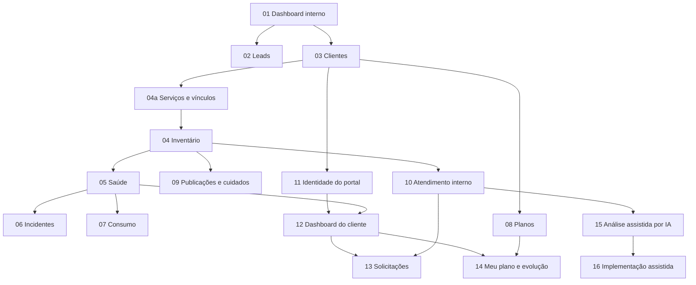

# Épica — Administração Olivaw e portal do cliente

## Estado e finalidade

Proposta criada em 20/10/2026 e decomposta em features em 21/10/2026. Este documento é o índice e a visão comum da épica; os arquivos abaixo definem escopo, dependências, exclusões, critérios de aceite e decisões de cada entrega.

A decomposição em features é documental. A primeira versão do dashboard foi posteriormente implementada para avaliação, conforme o estado da feature 01; a consulta de leads está disponível e o cadastro de clientes tem implementação local e migration PostgreSQL revisada, pendentes de publicação/teste na AWS; as demais continuam planejadas. Este índice não cria issues, aprova schemas/migrations ou autoriza provisionamento e publicação. Os números são referências de planejamento, não números de issues nem versões de release.

A visão permanece dividida em duas fases:

- **Operação Olivaw:** área interna para conhecer clientes, seus sistemas, saúde, consumo e necessidades.
- **Meu negócio:** portal em que cada cliente acompanha somente seus sistemas e conversa com a Olivaw em linguagem simples.

Agentes de IA entram gradualmente no atendimento e na evolução. Não são requisito para começar o dashboard nem para atender manualmente um cliente.

## Começar por aqui

A primeira implementação é [01 — Dashboard administrativo da Olivaw](done/01-dashboard-administrativo.md).

Vamos substituir a tela básica de `/admin` por uma experiência própria da operação: layout administrativo, identificação do operador, navegação responsiva, visão geral e estados vazios honestos. Aproveitamos login e logout existentes e confirmamos a autorização interna.

Essa primeira feature não precisa esperar CRUD de clientes, inventário ou coletores. Sem fontes conectadas, não apresenta números inventados, gráficos demonstrativos como reais ou cartões dizendo que tudo está saudável. O menu cresce com as funcionalidades entregues, evitando uma administração cheia de páginas sem função.

O painel inicial estará concluído quando um operador autorizado puder entrar, entender o contexto, navegar pelo que realmente estiver disponível e sair, em desktop e celular. As métricas entram pelas features que fornecem os dados.

## Features da operação interna

**Prioridade anterior de planejamento:** [04a — Cadastro de serviços e vínculo com clientes](done/04a-cadastro-de-servicos.md). Primeiro registrar quais serviços atendem cada empresa; depois avançar no inventário de ambientes/recursos e retomar o acompanhamento comercial de leads. A numeração original identifica os documentos e não representa mais uma fila estrita de implementação.

Em 22/10/2026, a feature 02b de acompanhamento de leads foi implementada e validada localmente a pedido do mantenedor. A base de cadastro de serviços foi implementada localmente na issue 018; ambientes e recursos aguardam definição do próximo recorte.

As entregas implementadas estão em [features concluídas](done/README.md). A consulta de leads foi encerrada como recorte próprio; [acompanhamento comercial](done/02-acompanhamento-comercial-de-leads.md) foi implementado e validado localmente, com publicação pendente. A organização em `done` não substitui publicação nem validação na AWS.

| Ordem sugerida | Feature | Resultado próprio | Dependência principal |
| --- | --- | --- | --- |
| 01 | [Dashboard administrativo](done/01-dashboard-administrativo.md) | Estrutura visual e entrada da operação | Autenticação existente e autorização interna |
| 02 | [Leads administrativos](done/02-leads-administrativos.md) | Consultar e acompanhar contatos recebidos | Dashboard e persistência de leads |
| 02b | [Acompanhamento comercial](done/02-acompanhamento-comercial-de-leads.md) | Etapas, notas internas e histórico | Consulta de leads |
| 03 | [Cadastro de clientes](done/03-cadastro-de-clientes.md) | Empresas, contatos e responsáveis | Dashboard; leads apenas para conversão |
| 04a | [Cadastro de serviços](done/04a-cadastro-de-servicos.md) | Serviços técnicos e seus vínculos com clientes; base validada, migration pendente | Clientes |
| 04 | [Inventário de recursos](painel-olivaw/04-inventario-de-recursos.md) | Recursos dedicados/compartilhados, ambientes e vínculos por cliente, preparando atribuição de custos | Clientes e serviços |
| 05 | [Coleta e saúde](painel-olivaw/05-coleta-e-saude.md) | Primeira verificação real e seus limites | Inventário e fonte autorizada |
| 06 | [Alertas e incidentes](painel-olivaw/06-alertas-e-incidentes.md) | Impacto, responsável, avaliação e recuperação | Inventário e coleta |
| 07 | [Consumo e capacidade](painel-olivaw/07-consumo-e-capacidade.md) | Primeira medida atribuível e histórico | Inventário e coleta confiável |
| 08 | [Planos e condições](painel-olivaw/08-planos-e-condicoes.md) | Condições aprovadas, limites e vigências | Clientes e definição comercial |
| 09 | [Publicações e cuidados](painel-olivaw/09-publicacoes-e-cuidados.md) | Histórico técnico, backups e evidências | Inventário e integrações autorizadas |
| 10 | [Atendimento interno](painel-olivaw/10-atendimento-interno.md) | Fila de problemas, dúvidas e melhorias | Clientes e sistemas |

A ordem é uma proposta de prioridade, não uma cadeia rígida. Clientes podem começar sem leads; planos e atendimento não precisam esperar todas as métricas. As dependências obrigatórias e opcionais estão explicitadas em cada arquivo.

## Features do portal e da assistência por IA

| Referência | Feature | Resultado próprio | Dependência principal |
| --- | --- | --- | --- |
| 11 | [Identidade do portal](painel-olivaw/11-identidade-do-portal.md) | Acesso externo e vínculos seguros | Clientes e decisão de autoridade |
| 12 | [Dashboard Meu negócio](painel-olivaw/12-dashboard-do-cliente.md) | Saúde e contexto em linguagem simples | Identidade, inventário e saúde |
| 13 | [Solicitações do cliente](painel-olivaw/13-solicitacoes-do-cliente.md) | Abrir e acompanhar problemas, dúvidas e melhorias | Portal e atendimento interno |
| 14 | [Meu plano e evolução](painel-olivaw/14-plano-e-evolucao-no-portal.md) | Consultar condições e entregas combinadas | Portal, planos e atendimento |
| 15 | [Triagem e diagnóstico com IA](painel-olivaw/15-triagem-e-diagnostico-com-ia.md) | Análises e respostas preparadas para revisão | Atendimento e contexto autorizado |
| 16 | [Implementação assistida por IA](painel-olivaw/16-implementacao-assistida-por-ia.md) | Alteração isolada, testes e revisão | Assistência por IA e política de execução |

A feature 15 pode começar com atendimentos registrados pela equipe, sem depender do portal. A feature 16 exige uma política própria de execução e revisão; não é uma consequência automática de ligar a triagem.

## Histórico de entregas

[18 — Histórico de entregas e notas de versão](painel-olivaw/18-historico-de-entregas.md) registra funcionalidades implementadas por empresa e serviço e prevê uma linha do tempo no portal. As [solicitações do cliente](painel-olivaw/13-solicitacoes-do-cliente.md) também contemplam alterações nos aplicativos, capacidade e plano, sujeitas à avaliação da equipe. Ambas continuam planejadas.

## Financeiro

[17 — Financeiro da Olivaw](painel-olivaw/17-financeiro.md) reúne o planejamento de custos da operação, contas a pagar e receber, fluxo de caixa, resultado, impostos e precificação. Foi dividido em quatro entregas propostas, ainda sem implementação. Prevê também uma consulta futura de cobranças e pagamentos no portal, com isolamento por empresa e sem exposição dos custos ou margens internos.

## Fluxo de evolução

O diagrama resume as dependências principais; os arquivos especificam as adicionais. Cadastro manual de cliente não depende da conversão de lead.

## Princípios comuns

- Começar pelo que precisa de atenção e pelo próximo passo possível; apresentar cliente, projeto, recurso, ambiente e período quando aplicável.
- Recurso inventariado não equivale a recurso monitorado. Ausência de alerta não comprova saúde. Exibir fonte, atualização e lacunas.
- Separar consumo medido, estimativa de custo interno e valor do plano. Crescimento não autoriza cobrança extra, upgrade ou suspensão automática.
- Cliente é empresa; usuário é pessoa autorizada; conta técnica serve a uma finalidade operacional. Não confundir os três cadastros.
- Correção, manutenção, ajuste e funcionalidade nova têm classificação e condições próprias. Pedido recebido não muda contrato nem consome franquia automaticamente.
- Construir uma experiência útil com um cliente real, sem inventar dados da LTMJ, planos, resultados ou histórico de disponibilidade.
- Funcionalidades futuras não viram menus, indicadores ou integrações aparentes antes de estarem disponíveis.

## Identidade, permissões e dados

A operação usa a identidade administrativa interna da Olivaw. O portal terá sua autoridade e seus vínculos definidos na feature 11; não reutiliza silenciosamente a identidade interna nem as identidades dos aplicativos dos clientes. JWTs consumidores continuam sendo validados localmente.

Papéis de produto possíveis: administrador, operação técnica, atendimento, comercial/financeiro e consulta. Mapear permissões conforme cada feature for implementada. Não é necessário implementar um editor completo de perfis no primeiro dashboard; é necessário impedir acesso indevido a dados e operações desde o início. Root não deve virar a conta cotidiana de todos.

O servidor autoriza empresa, projeto, recurso, conversas e exportações. Guards e filtros da interface não substituem essa validação. Não expor segredos em fichas, logs ou navegador, nem usar credenciais amplas para consultar bancos de negócio de clientes.

Cada feature define a auditoria mínima de suas alterações, retenção pertinente e recuperação de falhas. Ações remotas, mudanças comerciais e publicação exigem autorização própria. Criar uma solicitação não autoriza merge ou deploy.

## Responsabilidade técnica proposta

| Parte | Responsabilidade |
| --- | --- |
| Frontend Olivaw | Operação interna e experiência de navegação; não executa integração com segredos no navegador |
| API Olivaw | Relação comercial, cadastro, inventário lógico, leads e permissões internas conforme escopo aprovado |
| API DevOps | Reaproveitar operações restritas existentes sem transformá-la em autoridade dos clientes |
| Coleta | Integrações limitadas e consolidação; localização e eventual serviço próprio são decisões da feature 05 |
| Portal | Experiência externa, identidade e contratos definidos a partir da feature 11 |
| Execução de IA | Fila, isolamento, ferramentas e artefatos definidos nas features 15 e 16 |

Não criar microservices preventivamente. Quando necessário, usar o gerador do monorepo. Entidades ficam em `Domain` do projeto de núcleo, nunca no projeto `.Api`; contratos e interfaces seguem os guias locais. Migrations não fazem parte desta decomposição e dependem de pedido explícito para o provedor solicitado.

## Direção visual comum

Fundo claro, superfícies discretas, bordas finas, respiro e títulos fortes. Azul profundo e verde suave sustentam a identidade; cores de estado têm significado e vêm acompanhadas de texto/ícone. Navegação compacta no desktop e acessível no celular.

Mini Olivaws acolhem e ajudam em estados vazios ou mensagens pontuais, sem competir com dados. Reutilizar os [originais e orientações de avatares](../../ms-olivaw-ng/design/brand/avatars/README.md). Movimentos são suaves, dispensáveis à ação e respeitam movimento reduzido. Manter contraste durante e depois das animações.

Títulos sugeridos: **Olivaw - Operação** e **Olivaw - Meu negócio**. Gráficos só entram quando uma comparação ou tendência tiver fonte real e ajudar a decidir.

## Critério para iniciar e concluir cada feature

Antes de codar, resolver as decisões que bloqueiam a entrega escolhida, conferir as instruções do módulo e confirmar contratos existentes. Não é necessário resolver toda a épica para implementar a feature 01.

Cada implementação deve validar os comportamentos alterados, as fronteiras de autorização e a experiência em desktop, celular, teclado e movimento reduzido. Documentar limitações e fontes ainda não conectadas. Atualizar o estado da feature com evidência do que foi entregue; não marcar as seguintes como prontas por terem infraestrutura em comum.

Pagamentos foram planejados na feature 17 e permanecem fora da implementação atual. Anexos, ações operacionais executáveis e respostas autônomas a clientes também exigem recortes próprios com requisitos e aceite antes da implementação.

## O que existe e o que falta

| Base observada no repositório | Como aproveitar | O que não presumir |
| --- | --- | --- |
| Login e rota `/admin` no frontend Olivaw | Ponto de entrada da administração | A primeira estrutura visual da operação está disponível; cadastros, coleta e dados operacionais ainda não foram integrados |
| Identidade administrativa da `ms-olivaw-api` e biblioteca Olivaw Identity | Acesso humano da equipe, perfis e permissões | Cadastro de cliente não é cadastro de usuário, nem conta técnica |
| Identidades próprias das APIs dos clientes | Preservar autonomia e isolamento | JWT da LTMJ não dá acesso ao painel interno Olivaw |
| API DevOps com jobs de implantação e limpeza | Integrar acompanhamento de operações autorizadas | O job de implantação atual não comprova saúde funcional após publicar nem oferece rollback automático |
| Readiness e instrumentação compartilhada configurável | Possíveis fontes de sinais e links técnicos | A existência de código de métricas não comprova que coleta, histórico e dashboards estejam ativos em produção |
| Captação de leads e jornada comercial | Futuramente acompanhar a passagem de lead para cliente | Lead enviado não deve virar cliente ativo ou receber recursos automaticamente |
| LTMJ como primeiro cliente informado pelo mantenedor | Primeiro caso de cadastro e avaliação da experiência | Não inventar seu consumo, disponibilidade histórica, plano ou metas de atendimento |

Referências locais: [administração atual](../../ms-olivaw-ng/src/app/features/admin/admin-page.ts), [API Olivaw](../../ms-olivaw-api/README.md), [identidade](../../olivaw-identity/README.md), [API DevOps](../../ms-devops-api/README.md) e [executor](../deploy-executor.md).

## Referências de mercado

Pesquisa em documentação oficial consultada em 20/10/2026. As referências inspiram comportamentos; não implicam contratação dessas plataformas ou adoção integral de seus produtos. A tradução para a Olivaw abaixo é uma proposta nossa.

| Referência | Comportamento observado | Aplicação proposta na Olivaw |
| --- | --- | --- |
| [Vercel Observability](https://vercel.com/docs/observability) | Relaciona métricas, logs e rastros para investigar projetos | Visão geral simples com aprofundamento por sistema, ambiente e ocorrência |
| [Vercel Spend Management](https://vercel.com/docs/spend-management) | Trabalha com limites, notificações e ações relacionadas a consumo | Antecipar necessidade de capacidade. Não copiar suspensão automática de produção como política padrão |
| [Grafana: agrupamento de notificações](https://grafana.com/docs/grafana/latest/alerting/fundamentals/notifications/group-alert-notifications/) | Agrupa alertas relacionados e controla repetição | Uma falha compartilhada deve gerar um incidente compreensível, sem centenas de avisos equivalentes |
| [Grafana: ausência de dados e erro](https://grafana.com/docs/grafana/latest/alerting/fundamentals/alert-rule-evaluation/nodata-and-error-states/) | Distingue ausência de resultados de falha na avaliação | Diferenciar “sem coleta”, “coleta atrasada” e “sistema indisponível” |
| [Atlassian Statuspage](https://support.atlassian.com/statuspage/docs/what-is-statuspage/) | Apresenta componentes, incidentes, histórico e atualizações aos interessados | Informar impacto e andamento para o cliente sem expor detalhes internos |
| [Zendesk Customer Portal](https://support.zendesk.com/hc/en-us/articles/4408846805530-Submitting-and-tracking-requests-in-the-help-center-Customer-Portal) | Permite abrir, acompanhar, comentar e consultar solicitações | Uma conversa rastreável com protocolo e histórico no portal |
| [Zendesk: transferência entre IA e equipe](https://support.zendesk.com/hc/en-us/articles/4408824482586-Managing-conversation-handoff-and-handback) | Distingue quem está conduzindo o atendimento | Mostrar quando uma análise é assistida e permitir continuidade humana com contexto |
| [Linear Customer Requests](https://linear.app/docs/customer-requests) | Liga pedidos de clientes a itens de trabalho e projetos | Conectar a mensagem original à melhoria planejada, à implementação e à entrega |
| [Stripe Customer Portal](https://docs.stripe.com/customer-management) | Oferece autoatendimento relacionado a conta e assinatura | Evolução futura para consultar plano e condições. Pagamentos e mudanças contratuais não entram automaticamente no MVP |

A combinação desejada é: profundidade operacional quando necessária, acompanhamento de solicitações fácil de entender e uma camada própria da Olivaw para conectar essas informações.

A pesquisa original continua como referência da visão. As funcionalidades devem ser implementadas pelos recortes acima, começando exclusivamente pelo dashboard administrativo quando a implementação for solicitada.
