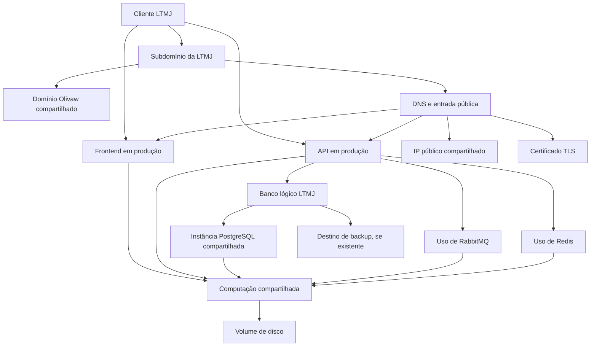

# 04 — Serviços, ambientes e recursos por cliente

## Estado e objetivo

Base implementada: [04a — Serviços](../done/04a-cadastro-de-servicos.md) e [04b — Inventário e ambientes](../done/04b-inventario-de-recursos.md), validadas localmente. O schema PostgreSQL está coberto pela migration `Issue020`; a interface e os casos de uso novos ainda precisam de publicação e smoke test no ambiente. Este documento conserva a visão completa e o planejamento restante da **04c — Detalhamento**, além das integrações futuras de medição/financeiro.

Parte da [épica de administração e portal](../painel-administrativo-e-portal-do-cliente.md). Os exemplos informados pelo mantenedor em 22/10/2026 não são cadastros automáticos nem autorizações de acesso à nuvem.

Responder: **quais serviços e recursos atendem cada cliente, quais são compartilhados, onde estão e quais dados permitirão projetar seu custo?**

O exemplo informado para a LTMJ inclui frontend Angular, API, PostgreSQL, RabbitMQ, Redis, uso do domínio Olivaw, IP público e disco. É um inventário declarado pelo mantenedor; instalações, vínculos, quantidades e valores ainda devem ser conferidos na operação. Não apresentar exemplos como descoberta técnica ou medição de produção.

## Dependências e entregas relacionadas

- [Cadastro de clientes](../done/03-cadastro-de-clientes.md).
- [04a — Cadastro de serviços e vínculos](../done/04a-cadastro-de-servicos.md), primeiro recorte deste planejamento.
- [07 — Consumo e capacidade](07-consumo-e-capacidade.md) fornecerá medições; o inventário pode começar manualmente.
- [17 — Financeiro](17-financeiro.md) manterá despesas, preços de referência, regras de rateio e projeções. Cadastro técnico não é cobrança ao cliente.
- [09 — Publicações e cuidados](09-publicacoes-e-cuidados.md) complementará informações de backups e evidências de restauração.

## Regra central

**Cadastrar cada recurso real uma vez e ligar todos os seus consumidores a ele.** Um PostgreSQL compartilhado não vira vários servidores cadastrados porque atende vários clientes. Um volume que guarda arquivos, bancos e logs também não vira um disco por aplicação.

Separar quem mantém, quem contrata/paga, quem é proprietário e quem utiliza. A Olivaw pode ser proprietária do domínio e contratante da infraestrutura, enquanto a LTMJ utiliza parte dessa estrutura. Vínculo de uso não transfere propriedade.

Serviço é a aplicação lógica, como `ms-ltmj-api`. Implantação representa esse serviço em um ambiente. Recursos são as dependências e capacidades que o suportam. Projeto/sistema pode agrupar serviços quando for útil, sem exigir um cadastro adicional para registrar a primeira aplicação.

## Modelagem proposta

Nomes de entidades abaixo são propostas de domínio, não tabelas já criadas. Entidades persistidas seguirão `Entity`, PK/FK internas `int` e `ExternalId` público, conforme o monorepo.

| Conceito                        | O que representa                                                              | Exemplo                                                                               |
| ------------------------------- | ----------------------------------------------------------------------------- | ------------------------------------------------------------------------------------- |
| Cliente                         | Empresa atendida, já cadastrada                                               | LTMJ                                                                                  |
| Serviço                         | Aplicação identificável, independente de ambiente                             | `ms-ltmj-api`, `ms-ltmj-ng`                                                           |
| Implantação do serviço          | Serviço em um ambiente, com localização e configuração de execução conhecidas | API LTMJ em produção                                                                  |
| Recurso                         | Instância, capacidade ou dependência identificável                            | VM, volume, instância PostgreSQL, banco lógico, domínio                               |
| Uso de recurso pela implantação | Qual recurso é utilizado, para quê e desde quando                             | API de produção utiliza o banco LTMJ                                                  |
| Relação entre recursos          | Como recursos se conectam                                                     | Banco pertence à instância PostgreSQL; instância executa na VM; dados ocupam o volume |
| Vínculo do recurso com cliente  | Beneficiário, finalidade, origem do vínculo e vigência                        | LTMJ utiliza um subdomínio e parte da infraestrutura compartilhada                    |

### Cardinalidades e vínculos

- Cliente e serviço: muitos para muitos, aproveitando a feature 04a. Serviços internos da Olivaw têm escopo explícito, sem cliente fictício.
- Serviço tem implantações por ambiente; ambientes sugeridos: desenvolvimento, homologação e produção. Não criar ambientes ou implantações inexistentes automaticamente.
- Implantação e recurso: muitos para muitos, com finalidade do uso. Uma API usa banco, cache e fila; uma instância de banco pode atender várias APIs.
- Recurso pode se relacionar a outros recursos. Tipos iniciais propostos: faz parte de, executa em, armazena em, exposto por e depende de. Validar tipos compatíveis, impedir autorreferência e ciclos em relações de composição; não impor uma árvore única a dependências que podem ser compartilhadas.
- Recursos também podem beneficiar o cliente diretamente, como um domínio próprio, sem depender de existir uma API. Registrar vínculo explícito ou origem inferida pelas implantações, distinguindo os dois.
- A visão do cliente reúne vínculos diretos e recursos alcançados pelas dependências. Deduplicar por identidade do recurso e mostrar o caminho de origem; chegar ao mesmo disco por API e banco não representa dois discos.
- Vínculo informa início/fim de vigência. Encerramento conserva o histórico. Alterar a topologia atual não reescreve os recursos utilizados em meses anteriores.

A relação técnica mostra dependência; o vínculo comercial identifica beneficiário; a regra financeira define atribuição de custo. Essas três informações se relacionam, mas uma não determina automaticamente as outras.

### Campos comuns do recurso

- Nome, identificador interno estável, tipo e finalidade.
- Provedor e referência da conta/contrato, região/localização e identificador externo quando disponíveis. Não exigir identificador inventado para recurso ainda não conferido.
- Contratante/pagador, proprietário e responsável operacional.
- Situação cadastral, escopo interno ou de clientes, entrada/encerramento de uso e estado de confirmação: informado, conferido ou desativado.
- Capacidade e unidade quando aplicáveis, distinguindo capacidade física/contratada de reserva para aplicações. Toda medida informa unidade: por exemplo, GiB, GB, vCPU ou MiB.
- Referências técnicas necessárias, datas relevantes, fonte da informação e última conferência.
- Cobertura de monitoramento: não configurada, planejada ou vinculada a uma fonte existente. Não declarar saudável por estar cadastrado.

Identidade externa deve ser única no escopo correto de provedor/conta/região/tipo. IP ou URL podem mudar e não substituem a identidade estável do cadastro. Uma VM recriada com novo identificador deve preservar rastreabilidade, sem transformar o novo ativo no antigo silenciosamente.

Campos usados em busca, filtros, vínculos, capacidade e futura composição de custos serão tipados e consultáveis. Preferir colunas e detalhes específicos por tipo às informações de negócio em um grande JSON ou em pares livres de chave/valor. Metadados livres ficam restritos a etiquetas e anotações complementares.

## O que inventariar

A tabela é um checklist, não uma exigência de que a LTMJ utilize todos esses recursos. Cadastrar apenas o que existir ou estiver explicitamente planejado.

| Grupo                  | Recursos e detalhes relevantes                                                                                                           |
| ---------------------- | ---------------------------------------------------------------------------------------------------------------------------------------- |
| Aplicações             | Frontend, API, workers, tarefas agendadas; implantação, ambiente, referência do repositório, CPU/memória reservadas e limites conhecidos |
| Computação             | VM, host, cluster ou runtime gerenciado; capacidade, região, perfil, responsabilidades e consumidores                                    |
| Banco                  | Instância/cluster PostgreSQL e bancos lógicos por cliente; schemas quando relevantes, capacidade/reserva e vínculos de armazenamento     |
| Mensageria             | Instância RabbitMQ e separações lógicas, como virtual host; filas e retenção apenas quando forem úteis ao inventário/medição             |
| Cache                  | Instância Redis e separação lógica efetivamente usada; limite, persistência, política de retenção/expiração e consumidores               |
| Armazenamento          | Volumes, disco local, arquivos de clientes, objetos/buckets, anexos, imagens, logs e dados persistentes de containers; tipo e capacidade |
| Rede e exposição       | IP público, IP reservado quando houver, DNS, zona/registros, proxy/ingress, balanceador, gateway/NAT, CDN e caminhos de tráfego          |
| Domínios e acesso      | Domínio registrado, subdomínios, destinos DNS, responsável, renovação e certificado TLS com cobertura/validade                           |
| Proteção e recuperação | Destinos de backup, snapshots, cópias adicionais, política de frequência/retenção e referência da última restauração verificada          |
| Observabilidade        | Coleta e retenção de logs, métricas, traces, alertas e armazenamento associado                                                           |
| Entrega e ferramentas  | Registro de imagens, armazenamento de artefatos, minutos de build/CI, licenças e ferramentas contratadas, quando existirem               |
| Serviços externos      | E-mail transacional, mensagens, APIs de terceiros, IA e armazenamento externo; conta/contrato, finalidade e consumidores                 |

### Recursos físicos, lógicos e compartilhados

- **PostgreSQL:** uma instância compartilhada é um recurso; o banco lógico LTMJ é outro, ligado à instância. Tamanho do banco ajuda a atribuir armazenamento, mas não prova sozinho consumo de CPU ou memória do servidor.
- **RabbitMQ:** separar broker compartilhado de virtual host/filas do cliente quando essa separação realmente existir. Fila acumulada também pode ocupar memória e disco; registrar política, sem presumir medição disponível.
- **Redis:** identificar a instância compartilhada e a separação adotada. Prefixo de chave é organização lógica, não comprovação de isolamento ou cota de memória. Não inventariar cada chave; futura medição precisa indicar suas limitações.
- **Disco:** cadastrar o volume real e distinguir usos lógicos por banco, arquivos, filas e logs. Reserva, limite e ocupação medida são informações diferentes. A soma das projeções deve identificar sobreposição ou ausência de atribuição.
- **Domínio:** registrar `olivaw.com.br` uma vez; registrar o subdomínio do cliente e suas relações com DNS, certificado, destino e serviços. Subdomínio não é uma nova compra de domínio; eventual custo específico só existe quando houver fonte que o comprove.
- **IP público:** cadastrar o recurso de rede compartilhado e relacioná-lo ao host/proxy e aos destinos atendidos. Não contar um IP por URL ou serviço. Registrar mudanças de associação e vigência.
- **Containers:** implantação e eventual recurso de runtime não devem representar o mesmo consumo duas vezes. Container em VM própria não ganha custo adicional fictício só por existir; runtime cobrado separadamente exige fonte identificável.
- **Backup:** a política de backup descreve o cuidado; cópias e destinos representam dados/armazenamento. A existência da política não comprova execução nem restauração bem-sucedida.

## Exemplo de organização da LTMJ

Exemplo conceitual a conferir antes do cadastro. A hospedagem conjunta na mesma VM e a separação lógica dos componentes abaixo são hipóteses ilustrativas; a lista de tecnologias foi informada pelo mantenedor.

A ficha deve distinguir: **“usa a instância PostgreSQL compartilhada”**, **“possui banco lógico dedicado”**, **“usa subdomínio da Olivaw”** e **“utiliza capacidade deste volume”**. Isso é mais informativo do que uma lista plana de tecnologias e permite compreender impacto de falha e crescimento.

Clientes diferentes podem apontar para a mesma VM, IP, domínio, PostgreSQL, RabbitMQ, Redis ou destino de backup. Eles não precisam utilizar todos os mesmos componentes nem ter a mesma regra de atribuição de custo.

## Preparação para projetar custos

Este inventário fornece identidade e vínculos; medições ficam na feature 07, e despesas/preços/rateios na feature 17. Não cadastrar preço estimado na tela de recurso como se fosse despesa paga ou mensalidade do cliente.

### Informações financeiras a relacionar depois

- Identificação da origem cobrada: recurso, fornecedor, item do contrato/fatura, período e moeda. Despesa sem recurso específico pode permanecer no centro de custo da plataforma.
- Modelo de custo: recorrente fixo, por hora, capacidade provisionada, volume armazenado, tráfego, requisições ou outra unidade definida pelo contrato real.
- Fonte e vigência do preço; distinguir referência estimada, fatura confirmada e pagamento realizado.
- Frequência e datas: mensal, anual, sob demanda e proporcionalidade de tempo quando comprovada pelo contrato. Projeção mensal de uma renovação anual não altera a data do desembolso no fluxo de caixa.
- Vínculos vigentes, qualidade e período da medição, regra de rateio aprovada e parcela sem atribuição.

### Regras para evitar custo duplicado

1. Cada item de custo tem uma origem canônica. Se um volume já está contado na despesa do fornecedor, uso pelo PostgreSQL ou pela API distribui essa despesa; não cria nova cobrança de disco.
2. Custo direto de um recurso dedicado pode ser atribuído ao cliente correspondente. Custo compartilhado exige regra explícita e versionada, definida no financeiro; vínculo não equivale a percentual.
3. Distinguir rateio por capacidade reservada, uso medido, participação fixa ou outra política aprovada. Divisão igual é uma política possível, não uma medição nem um default silencioso.
4. Somar percentuais/valores atribuídos respeitando o total do item e período. Manter sobra identificada como plataforma, capacidade ociosa ou não atribuída, conforme classificação confirmada.
5. Se VM, volume, tráfego e IP tiverem itens separados no contrato/fatura, tratá-los como origens distintas. Se um pacote já os incluir, impedir que os componentes sejam somados novamente.
6. Registrar cobrança monetária onde ela realmente ocorre. Banco lógico, namespace, subdomínio e container podem ser apenas unidades de atribuição, sem despesa própria adicional.
7. Não calcular custo individual de CPU por tamanho do banco, nem atribuir todo o uso da VM a um único cliente sem evidência. Dado ausente fica como pendência, não como custo zero confirmado.

Uma futura projeção por cliente poderá reunir computação atribuída, dados/arquivos, backup, rede, serviços externos e a parcela aprovada de custos compartilhados. Reserva operacional, suporte, impostos e margem serão considerados na precificação financeira; não são métricas físicas deste inventário. O resultado não altera plano nem gera cobrança automática.

## Forma de cadastrar e consultar

1. **Registrar serviços e implantações conhecidas:** selecionar o cliente existente e identificar frontend/API/worker e ambiente.
2. **Cadastrar os recursos reais:** começar com os compartilhados da Olivaw e suas capacidades conhecidas; confirmar os identificadores antes de criar duplicatas.
3. **Vincular dependências:** ao cadastrar o banco lógico LTMJ, escolher a instância PostgreSQL já cadastrada; ao vinculá-lo à API, registrar a finalidade.
4. **Vincular beneficiários:** mostrar recursos diretos e herdados pela cadeia, sua origem e compartilhamento. Cadastrar exceções justificadas, como domínio próprio do cliente sem aplicação ainda implantada.
5. **Acrescentar capacidade e referências:** informar fonte e unidade; consumo atual e custo só aparecem quando houver seus módulos/fontes.

Na interface:

- **Serviços:** aplicações e seus ambientes.
- **Recursos:** catálogo único, com filtros por tipo, provedor, cliente, ambiente, situação e compartilhamento.
- **Ficha do cliente → Recursos:** recurso, tipo, forma de vínculo, exclusividade/compartilhamento, capacidade/reserva conhecida e conferência. Oferecer **Vincular recurso existente** antes de incentivar duplicação.
- **Ficha do recurso:** consumidores, relações técnicas, responsáveis e histórico; referências a uso e custos entram quando disponíveis.
- A consulta interna mostra o impacto entre clientes de uma dependência compartilhada. O portal futuro mostra apenas a relação do próprio cliente, sem expor demais clientes, contas, custos internos ou credenciais.

Não exigir que o operador preencha toda a infraestrutura para salvar o primeiro recurso. Dados incompletos devem ser identificados com pendências explícitas; o cadastro começa progressivo.

## Recortes de implementação

- **04a — Serviços:** aplicações e vínculo com clientes, conforme documento próprio.
- **04b — Base do inventário:** implantações/ambientes, cadastro único de recursos, tipos comuns, relações, vínculos com clientes e identificação de compartilhamento. Começar pelos componentes informados para a LTMJ e pelos recursos de plataforma efetivamente confirmados, sem pré-cadastrá-los automaticamente.
- **04c — Detalhamento:** propriedades por tipo, refinamento de sub-recursos, referências de backup/renovação e histórico de mudanças de alocação conforme necessidades reais.
- **07 e 17 — Medição e custo:** coleta atribuível, preços, despesas, rateios e projeções, entregues e verificadas separadamente. O cadastro útil não depende de integração automática com AWS.

## Fora desta entrega

- Provisionar, descobrir recursos remotos automaticamente, executar comandos ou verificar URLs durante o cadastro.
- Armazenar senhas, tokens, connection strings ou chaves privadas nos registros do inventário. Referências operacionais autorizadas não revelam o segredo.
- Produzir métricas reais, orçamento, fatura, rateio automático ou alteração de plano somente por cadastrar recursos.
- Importar configurações ou acessar bancos reais como efeito da implementação ou de testes.

## Critérios de aceite

- Operador identifica recursos diretos e compartilhados de um cliente, com caminho técnico, finalidade, responsáveis e fonte da informação.
- Recursos compartilhados têm identidade única. Busca e validação evitam duplicidade no escopo de provedor/conta/região; vínculos repetidos são tratados claramente.
- A mesma dependência alcançada por diferentes caminhos aparece uma vez no resumo, com suas relações preservadas.
- Recursos físicos, unidades lógicas, reservas e medições são distinguíveis. Unidades e ausência de informação são explícitas.
- Remover vínculo ou encerrar serviço conserva vigência e histórico; não exclui recursos utilizados por outros clientes nem aciona infraestrutura/cobrança.
- Identificar sobreposição de projeções/capacidade e possíveis fontes duplicadas de custo; a simulação financeira posterior deve reconciliar o total atribuído com a origem.
- Autorização no servidor protege cadastros, vínculos e consultas. Relações e URLs são validadas como dados; destinos de coleta futura obedecerão a política própria.
- Um recurso sem coleta aparece como inventariado, com saúde/consumo não confirmados. Cadastro e testes não inventam quantidade, disponibilidade, isolamento, preço ou plano da LTMJ.

## Dados operacionais a conferir e evolução da 04c

- Onde cada componente da LTMJ está realmente hospedado, ambientes utilizados e quais instâncias são compartilhadas com outros clientes ou com a operação Olivaw.
- Se existem banco/schema, virtual host, separação Redis e armazenamento por cliente, e quais são apenas convenções de nomes.
- Tipos mínimos, propriedades por tipo, identificadores, responsáveis e referências de provedor/conta.
- Critérios de vínculo direto/inferido, regras de composição e encerramento, representação de recursos internos e forma de registrar mudanças de ambiente.
- Qual capacidade pode ser cadastrada com confiança agora e quais medições precisam esperar coletores.
- Quais despesas já têm origem identificável no fornecedor e quais critérios de rateio serão avaliados no financeiro. Não escolher percentuais sem evidência ou aprovação.
