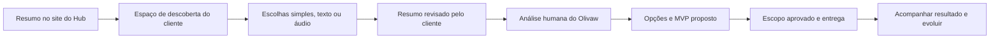

# Protocolo Olivaw de descoberta e evolução

## Objetivo e estado

Proposta v0.1, aplicada inicialmente à LTMJ Eventos. Conhecer o negócio, identificar uma melhoria de valor imediato e entregar um MVP que caiba na realidade do cliente. O Olivaw Hub atua como parceiro de inteligência de negócio; o processo não presume que o cliente saiba especificar software.

Este é o desenho do processo e de um futuro produto do Hub. Não existe ainda portal de briefing, transcrição de áudio, recomendação automática ou contratação online em produção. O [protótipo navegável](prototipos/briefing-cliente.html) funciona localmente, sem servidor ou envio de dados.

## Jornada proposta

O resumo inicial deve ser reaproveitado na próxima interface, sem repetir perguntas. A interface futura será definida separadamente. Respostas e prioridades podem mudar; guardar versão, data, origem e quem aprovou.

## Princípios da conversa

- Uma pergunta principal por etapa; escolhas de clique, exemplos próximos do setor e texto opcional.
- Sempre permitir “não sei ainda”, “outro” e pular o que não é essencial.
- Não tratar falta de resposta como resposta negativa. Guardar `não informado`, `não sei` e `respondido` separadamente.
- Separar o que o cliente disse, o que observamos publicamente e nossas hipóteses.
- Explicar por que pedimos cada informação; não pedir senhas, documentos ou dados de clientes nessa descoberta.
- Não prometer receita, resultado de campanha ou automação de negócio sem validação.
- Mostrar um resumo editável antes de qualquer envio e explicar quem receberá as informações.

## Etapas e perguntas

| Etapa             | Pergunta principal                    | Escolhas e aprofundamento                                                                                                                                                       |
| ----------------- | ------------------------------------- | ------------------------------------------------------------------------------------------------------------------------------------------------------------------------------- |
| 1. Seu negócio    | O que você faz e para quem?           | Segmento; serviços/produtos; cidade/região; particular/empresas/ambos; história de como começou em texto ou áudio opcional.                                                     |
| 2. Seu momento    | O que mais ajudaria hoje?             | Divulgar melhor; receber pedidos/orçamentos; organizar agenda; controlar despesas/lucro; organizar clientes; não sei. Permitir várias e escolher uma prioridade.                |
| 3. Sua rotina     | Como isso funciona hoje?              | WhatsApp; papel; planilha; redes sociais; sistema; outra pessoa cuida. Perguntar onde perde tempo, erra ou deixa de atender.                                                    |
| 4. Seu cliente    | O que as pessoas mais perguntam?      | Preço; disponibilidade; localização; cardápio; fotos; como contratar; outros. Read dúvidas recorrentes e a ação desejada do visitante.                                    |
| 5. Sua identidade | Como quer ser reconhecido?            | Próximo/sofisticado/alegre/tradicional/moderno; cores; logo; referências; o que evitar. Links de redes com confirmação de titularidade.                                         |
| 6. Material       | O que já tem para começar?            | Logo; fotos; vídeos; serviços; preços; depoimentos autorizados; nada organizado. Registrar autoria, origem e autorização para publicação.                                       |
| 7. Restrições     | O que precisa caber na sua realidade? | Prazo ou data importante; faixa de investimento opcional; tempo para manter; pessoa responsável; “quero ajuda para decidir”. Não mostrar valores de pacote ainda não definidos. |
| 8. Revisão        | Entendemos corretamente?              | Resumo em linguagem simples; correções; pendências; aprovação para análise. A proposta comercial é uma etapa posterior.                                                         |

### Ramificações por necessidade

- **Marketing:** público, oferta, região, canal atual e objetivo da campanha. Página e mensagem podem preceder anúncios; gestão de anúncios e verba são itens separados.
- **Pedidos/orçamentos:** itens, personalização, prazo de resposta, como fechar e canal responsável. Começar por um pedido estruturado antes de pagamento online.
- **Agenda:** quem atende, duração, capacidade, confirmação e cancelamento. Não prometer disponibilidade em tempo real sem fonte confiável.
- **Financeiro:** como registra entradas/despesas hoje, categorias e pergunta que precisa responder. Distinguir organização gerencial de contabilidade e integrações bancárias.
- **“Não sei”:** oferecer exemplos de situações: “respondo a mesma dúvida”, “esqueço pedidos”, “não sei quanto sobrou”, “meu trabalho não aparece”. Investigar uma situação concreta antes de sugerir sistema.

## Texto e áudio na interface futura

Áudio é alternativa, não obrigatório. Prever envio de arquivo e gravação com permissão explícita, limites visíveis, progresso, cancelar/remover e revisão da transcrição. Definir formatos, tamanho, armazenamento, acesso, retenção e custo antes de implementar. A transcrição precisa poder ser corrigida; não inferir aprovação, identidade ou fatos a partir de uma transcrição incerta. O protótipo atual só registra a preferência pelo canal, não captura nem envia áudio.

## Da descoberta ao MVP

O Olivaw prepara opções, sem exigir que o cliente monte sozinho uma lista técnica. Cada funcionalidade proposta informa: problema atendido, resultado observável, esforço/dependências, custo de implantação/manutenção a definir, conteúdo necessário e o que fica fora.

| Critério        | Pergunta de avaliação                                            |
| --------------- | ---------------------------------------------------------------- |
| Valor imediato  | Resolve a principal dificuldade relatada?                        |
| Prontidão       | Existem material, processo e responsável para usar?              |
| Esforço e risco | Depende de integração, dados, manutenção frequente ou terceiros? |
| Validação       | Podemos medir uso/resultado com uma primeira entrega menor?      |

Não automatizar a escolha por uma pontuação sem contexto. A análise humana recomenda um pequeno conjunto coerente e o cliente aprova. Prazo e investimento só entram na proposta depois de estimar o escopo.

### Famílias de funcionalidades, não planos comerciais fechados

1. **Presença:** landing page, serviços, portfólio, contato e indexação básica.
2. **Atendimento:** pedido/orçamento estruturado, organização de contatos e acompanhamento.
3. **Conteúdo:** administração de eventos, fotos, categorias e publicação.
4. **Operação:** agenda, pedidos, equipe e tarefas, conforme processo real.
5. **Gestão:** entradas/despesas e visão gerencial de resultado.
6. **Divulgação:** páginas de campanha e acompanhamento de origem; anúncios contratados à parte.

## Registro de saída por cliente

- Identidade do negócio e contato responsável; objetivos e origem das respostas.
- Resumo confirmado, fatos observados, hipóteses e pendências.
- MVP proposto, escopo excluído, critérios de aceite e responsáveis por conteúdo/aprovação.
- Backlog por fase, dependências e estimativa comercial ainda não aprovada.
- Identificador do cliente e dos projetos frontend/backend; sem misturar dados ou chaves entre organizações.
- Histórico de entregas e métricas que o cliente concordou em acompanhar.

## Primeiro experimento: LTMJ

Aplicação detalhada em [LTMJ: briefing e MVP](../ms-ltmj-ng/docs/briefing-e-mvp.md). O teste deve avaliar se o cliente consegue descrever o negócio sem ajuda técnica, se o resumo representa suas prioridades e se o MVP é compreensível. Registrar dúvidas e abandono por etapa, sem coletar conteúdo privado desnecessário.
